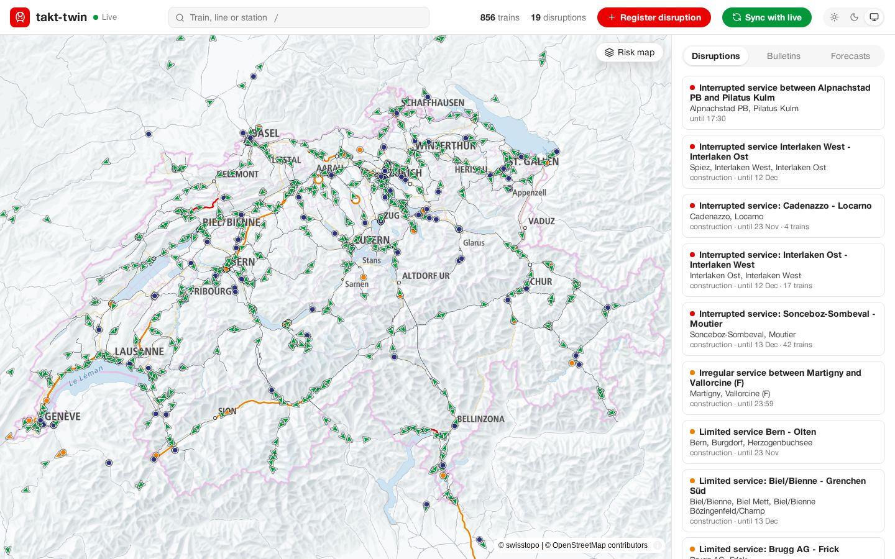
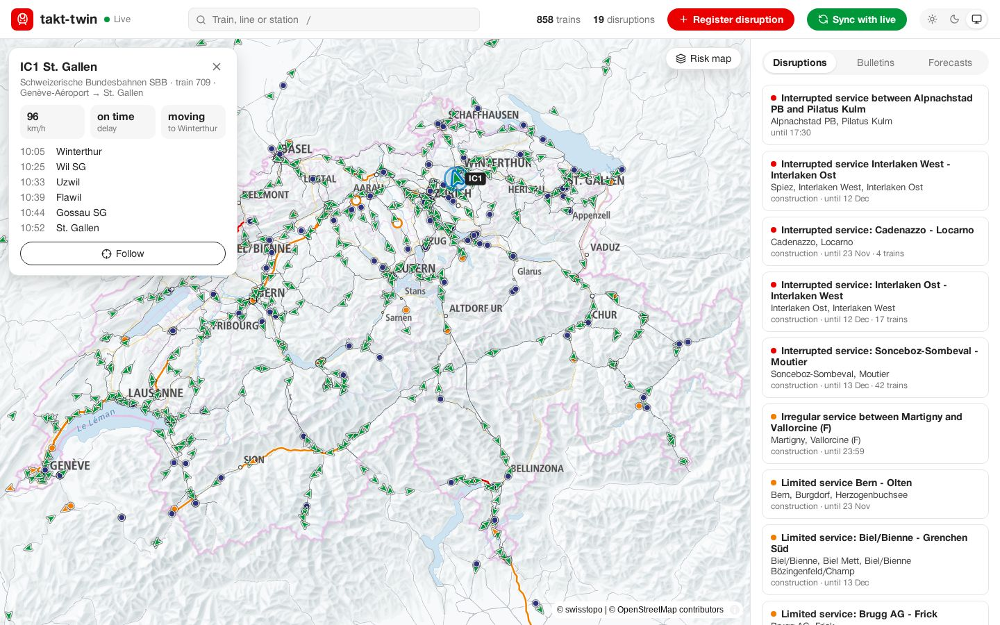
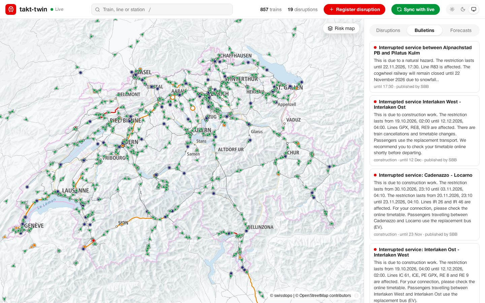
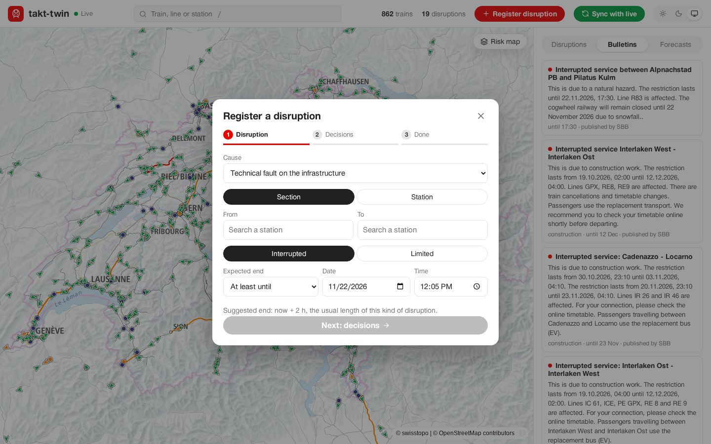
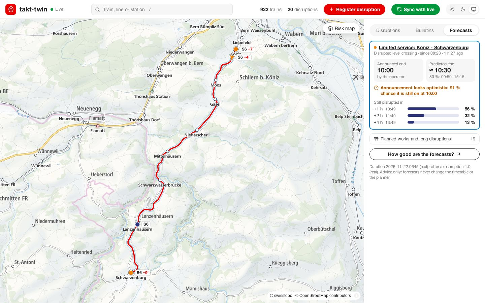
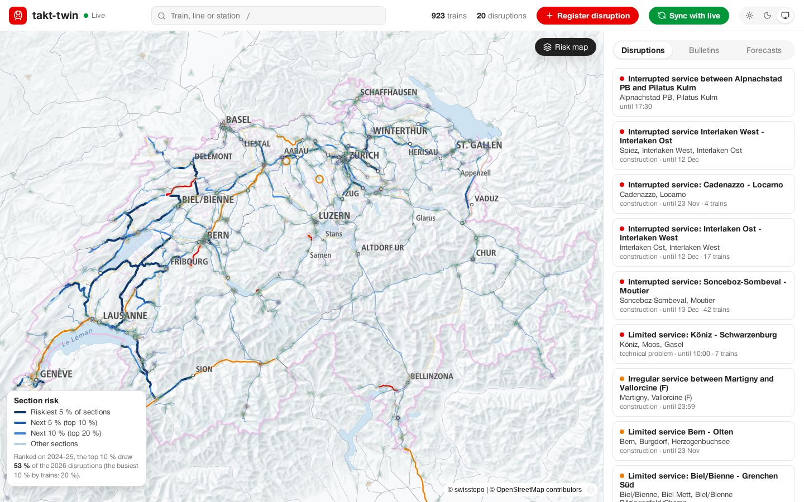
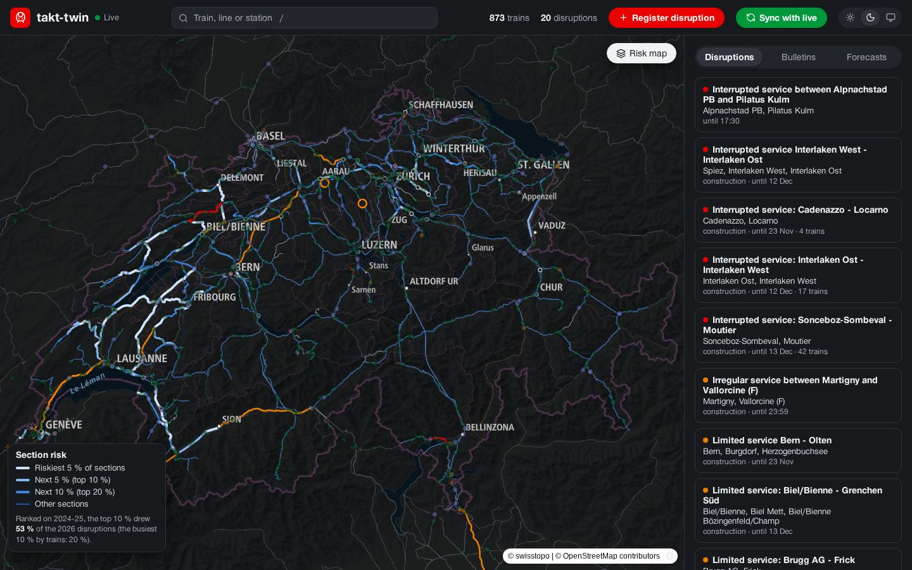

# sbb-twin

A live digital twin of every Swiss train. sbb-twin was built at LauzHack 2026 for SBB's challenge on assisting
customers during disruptions: it is the data layer and control centre behind the team's passenger app
[Takt](https://takt.latragallucci.dev). The live twin runs at **[twin.latragallucci.dev](https://twin.latragallucci.dev)**,
where its web app, **takt-twin**, shows every train and lets staff register disruptions and decide what is done about
them.



- **Live trains**: every train in service, one position per second, computed from the official timetable (GTFS) and the
  official real-time predictions (GTFS-RT delays, cancellations, skipped stops), along the real track geometry of the
  federal rail network (BAV), with realistic acceleration and braking.
- **Disruptions on the railway**: the real SBB service alerts that touch the railway, placed on the track, and the
  incidents the twin detects from what trains do (stopped on the line, running slowly, held, late, cancelled).
- **Disruption console**: register a disruption (a cause on a section or a station, interrupted or limited, an
  expected end) in takt-twin or over the API, with the control centre's decisions: hold trains, short turns,
  replacement buses, cancelled lines, one track open, partial reopening, a new prognosis, service resumed.
- **Effective timetable**: held, short-turned and cancelled trains and the replacement buses are part of the timetable
  that train info, station boards, briefs and the journey planner read.
- **Bulletins**: an SBB-style passenger bulletin for each registered disruption, a new version at every change,
  optionally reworded by Claude behind a validator, which also writes German, French and Italian versions on request.
- **Brief**: one call returns what matters for a station, a route or a location (built for the passenger assistant).
- **Journey planner** on the live state: delays, held and cancelled trains, closed sections and replacement buses,
  with changes, alternatives and the fastest option that does not rely on an unconfirmed reopening.
- **Station boards and arrivals**, and **search** for trains, lines and stations.
- **Forecasts**: how long a disruption will last, which trains to check after "Service resumed", and a section risk
  map ([docs/forecasts.md](docs/forecasts.md)).
- **Outputs**: MQTT for other teams, a WebSocket for the console, an HTTP API.
- **takt-twin**: the live map with train and station cards, the console, bulletins, forecasts, the risk map, and a
  light, dark or system theme.

| A train and its next stops | Bulletins | Registering a disruption |
|---|---|---|
|  |  |  |
| **Forecasts for a disruption** | **Section risk map** | **Dark mode** |
|  |  |  |

**How it all works: [docs/how-the-twin-works.md](docs/how-the-twin-works.md)** (data, train movement, disruptions,
bulletins, the planner, outputs, the viewer, running it). Forecasts: [docs/forecasts.md](docs/forecasts.md). Apps
built on this data follow one look: [docs/sbb-style.md](docs/sbb-style.md) (SBB type, colours, train and disruption
colours, map conventions, components). A printable guide to all of it, with screenshots:
[docs/takt-twin-explained.pdf](docs/takt-twin-explained.pdf).

Other teams consume the MQTT feed (e.g. incident detection from positions, passenger or station UIs). takt-twin, the
page at `/`, is the twin's own console: it reads the twin directly (WebSocket `/live`, the whole state again after
every change), so it always shows exactly what the twin holds. MQTT is the twin's output for everybody else.

## Connect

sbb-twin publishes to the **team broker** (`MQTT_URL`); its address and credentials are shared in the team channel,
not in this public repository. Without `MQTT_URL` it runs its own broker (local and Docker).

| | Address | Credentials |
|---|---|---|
| Team broker, MQTT over TCP | `mqtt://<team-broker>:1883` | team user and password |
| Team broker through sbb-twin, MQTT over WebSocket | `wss://<public-host>/mqtt` | none: a **read-only** proxy limited to `sbb-twin/v1/#` |
| Own broker (no `MQTT_URL`) | `ws://127.0.0.1:8787/mqtt` (no TCP port is opened) | none (anonymous) |

MQTT 3.1.1. Publish only under `sbb-twin/v1/detections/{team}/…` and `sbb-twin/v1/ext/{team}/…` (the own broker
enforces it; on the team broker it is the rule). Use a unique client id and a clean session. Retained messages survive
restarts on the team broker: sbb-twin republishes its state when it starts and removes its stale ones within a minute.

```python
# pip install paho-mqtt==2.1.0
import json, os, paho.mqtt.client as mqtt
c = mqtt.Client(mqtt.CallbackAPIVersion.VERSION2)
c.username_pw_set(os.environ["MQTT_USERNAME"], os.environ["MQTT_PASSWORD"])
c.on_connect = lambda c, u, f, rc, p: c.subscribe("sbb-twin/v1/fleet")
c.on_message = lambda c, u, m: print(len(json.loads(m.payload)["trains"]), "trains")
c.connect(os.environ["MQTT_HOST"], 1883)
c.loop_forever()
```

```js
// npm i mqtt   (browsers: <script src="https://unpkg.com/mqtt@5.10.4/dist/mqtt.min.js"></script>)
const mqtt = require("mqtt");
const c = mqtt.connect("wss://<public-host>/mqtt");     // read-only, no credentials
c.on("connect", () => c.subscribe(["sbb-twin/v1/fleet", "sbb-twin/v1/trains/+/info"]));
c.on("message", (topic, bytes) => {
  if (!bytes.length) return;                  // empty payload = retained message deleted
  const msg = JSON.parse(bytes.toString());
  if (topic === "sbb-twin/v1/fleet") console.log(msg.trains.length, "trains at", new Date(msg.ts));
});
```

## Topics

All topics are under `sbb-twin/v1/` (`TOPIC_ROOT`). Payloads are UTF-8 JSON with a schema version `v`. Times are
**epoch milliseconds (UTC)**; Swiss local time is `Europe/Zurich`. Coordinates are WGS84 degrees. An **empty retained
payload is a tombstone**: the entity was removed.

| Topic | Retained | QoS | When | Content |
|---|---|---|---|---|
| `status` | yes | 1 | every 10 s | heartbeat: `streamId`, `tick`, timetable date, trains active and simulated, real-time and alerts feeds (enabled, age, error), active disruptions, broker, bulletin wording. No update for 30 s = offline |
| `fleet` | no | 0 | every second | **all trains in one message** (compact rows, see below). Best for maps and detectors |
| `trains/{trainId}/position` | no | 0 | every second | one train: position, speed, motion, delay, stops |
| `trains/{trainId}/info` | yes | 1 | on start, on change, tombstone at the end | line, number, operator, origin/destination (served and planned), every stop with planned/expected/actual times, skipped and cancelled calls, status (`active` / `cancelled` / `terminated`), the `disruptionId` that changed the run |
| `incidents/{incidentId}` | yes | 1 | on change, tombstone when closed | public incidents: marked by staff; detected by the twin itself (`source: "auto"`): a train stopped on the open line for 30 s (major), slow running under 40 % of the timetable pace for 60 s (minor), a train still at a station 3 min after it should have left (minor, major from 2 trains), a train 10 min late, or 4 min late and losing 2 min in 3 min (minor, until under 4 min), a cancelled train (minor); and each registered disruption's public face (`source: "control"`, see below) |
| `alerts/{alertId}` | yes | 1 | every 3 min when changed, tombstone when withdrawn | **real SBB service alerts that touch the railway** (opentransportdata.swiss GTFS-RT service alerts): title, description, cause, `severity` (`major` = interrupted, `minor` = limited, `info`), active periods, stations, affected `trainIds`, track geometry |
| `bulletins/{disruptionId}` | yes | 1 | every new version, tombstone 30 min after the disruption ended | **the passenger bulletin of a registered disruption**: `title`, `description` (one sentence per line), affected `lines`, `messages` (one per decision), `lifecycle` (`INFO` / `ENDED`), `version`, `source` (`template`, or `ai` when reworded by Claude) |
| `forecasts/disruptions` | yes | 1 | when a forecast changes (checked every 5 s) | **live duration forecasts** for every active disruption (real SBB alerts and twin disruptions): `horizons` (P still disrupted at +60/+120/+240 min), the end to show (`median`: announced end + 27.5 min while ahead, else the model median) with its 80 % `band`, the `announced` end, `optimistic` (P still on at the announced end > 0.6), `planned`, `say` (a sentence for the assistant), the model versions and whether each is `real` or `placeholder`. Advice only. Models: [research/duration](research/duration/README.md) |
| `forecasts/post-resumption/{disruptionId}` | yes | 1 | when a disruption resumes (a twin disruption, or a real SBB alert withdrawn), on an official status change, tombstone after the last train | **trains to check after "Service resumed"**: the regular trains due at the section's stations in the next hour, each with its historical risk of still losing a stop (`risk`, `band`: `check first` ≥ 25%, `check` 12-25%, `low` < 12%) and its `officialStatus` (`cancelled` / `skipped` in the effective timetable, else `scheduled`). Advice only: it never changes the timetable or the planner. Model and tests: [research/post_resumption](research/post_resumption/README.md) |
| `events/incident`, `events/train`, `events/system` | no | 0 | on occurrence | `incident.marked` / `incident.unmarked`, `train.cancelled`, `system.started` / `system.timetable` |
| `truth/disruptions/{id}` | yes | 1 | on change, tombstone 30 min after it ended | **ground truth**: disruptions registered in the twin and train actions, their state and measures, the trains they affected, geometry |
| `truth/trains/{trainId}` | yes | 1 | while simulated | ground truth: this train is following a disruption, not the real data |
| `truth/events` | no | 0 | on occurrence | `disruption.started`, `disruption.measure`, `disruption.state`, `disruption.ended`, `train.released`, `release.all`, `sync.trains` / `sync.all`, `reset` |
| `detections/{team}/{id}` | yes (yours) | 1 | yours | **reserved for the detection team**; tombstone when withdrawn |
| `ext/{team}/…` | yours | yours | yours | free namespace for other teams |

> **`truth/` is for evaluation and staff only.** A detector must infer incidents from `fleet`/`position`/`info`;
> reading `truth/` would be cheating. Positions never reveal whether a train is simulated.

**Which topic for what**

| You build | Subscribe to |
|---|---|
| a map of every train, an incident detector | `fleet` (one message per second with every train); `trains/+/info` for timetables |
| a passenger app following one train | `trains/{trainId}/position` and `trains/{trainId}/info` |
| a station screen | `trains/+/info`, keeping the calls with your `stopId` (or `GET /api/stations/{id}/board`) |
| passenger information about disruptions | `bulletins/+` (registered disruptions), `alerts/+` (real SBB alerts) and `incidents/+` |
| advice on how long a disruption lasts | `forecasts/disruptions` and `forecasts/post-resumption/+` |
| an evaluation of a detector | `truth/disruptions/+`, `truth/trains/+`, `truth/events` against your `detections/{team}/+` |

### `fleet` (every second)

```json
{ "v": 1, "streamId": "0b14f694249a4190", "tick": 188, "ts": 1795286212000,
  "fields": ["trainId","lat","lon","bearing","speedKmh","motion","delaySec","line","category","atStopId","continuity"],
  "trains": [["20261121_ojp-91-8-E.1.TA.716.j26", 47.383806, 8.023723, 60, 128.6, "moving", 0, "IC8", "IC", null, 1], …] }
```

A row's position is valid at `ts`. `motion` is `moving`, `stopped` or `cancelled`. A train missing from a newer `fleet`
message has left service.

### `trains/{trainId}/position` (every second)

```json
{ "v": 1, "streamId": "0b14f694249a4190", "tick": 188, "ts": 1795286212000,
  "trainId": "20261121_ojp-91-8-E.1.TA.716.j26",
  "lat": 47.383806, "lon": 8.023723, "bearing": 60, "speedKmh": 128.6,
  "motion": "moving", "delaySec": 0,
  "line": "IC8", "category": "IC", "headsign": "Romanshorn",
  "atStop": null,
  "prevStop": { "id": "8507000", "name": "Bern" },
  "nextStop": { "id": "8503000", "name": "Zürich HB", "plannedArr": 1795287480000, "expectedArr": 1795287480000 },
  "edgeId": "ch14uvag00087839", "track": "bav", "continuity": 1 }
```

| Field | Meaning |
|---|---|
| `trainId` | `{service date YYYYMMDD}_{GTFS trip_id without its leading dot}`: stable for the whole run, matches GTFS/GTFS-RT |
| `lat`, `lon`, `bearing` | on the track centreline; bearing in degrees clockwise from north |
| `speedKmh` | current speed |
| `motion` | `moving` or `stopped` (observable facts only) |
| `atStop` | the station the train stands at, else `null`. `stopped` with `atStop: null` = stopped on the open line |
| `delaySec` | delay in seconds (+ late) at the next stop: departure delay at intermediate stops, arrival delay at the terminus |
| `edgeId`, `track` | BAV track segment id; `track: "approx"` = no BAV match (mostly abroad or replacement buses): straight line between stops |
| `continuity` | increases when the train jumps (e.g. synced back to the real data): **do not interpolate across a change** |
| `streamId`, `tick` | `streamId` changes when sbb-twin restarts; `tick` increases by one per second within a stream |

**Smooth maps**: render about one second behind and interpolate each train between its last two positions; snap
when `continuity` or `streamId` changes. Speed and bearing allow extrapolating up to one second.

### `trains/{trainId}/info` (retained)

```json
{ "v": 1, "trainId": "20261121_ojp-91-8-E.1.TA.716.j26", "tripId": ".ojp-91-8-E.1.TA.716.j26", "serviceDate": "20261121",
  "line": "IC8", "category": "IC", "number": "10831", "operator": "Schweizerische Bundesbahnen SBB",
  "headsign": "Romanshorn", "status": "active",
  "origin": { "id": "8501609", "name": "Brig" }, "plannedOrigin": { "id": "8501609", "name": "Brig" }, "firstServedSequence": 0,
  "destination": { "id": "8506121", "name": "Romanshorn" }, "plannedDestination": { "id": "8506121", "name": "Romanshorn" },
  "lastServedSequence": 11, "disruptionId": null,
  "calls": [ { "stopId": "8506109", "name": "Amriswil", "lat": 47.55045, "lon": 9.302225,
               "plannedArr": 1795291560000, "plannedDep": 1795291560000,
               "expectedArr": 1795291540000, "expectedDep": 1795291560000,
               "actualArr": null, "actualDep": null, "skipped": false, "cancelled": false }, … ],
  "updatedAt": 1795286212390 }
```

`origin` and `destination` are the first and last stops the train serves; a short turn or a late start after a
registered disruption changes them (`plannedOrigin` and `plannedDestination` keep the timetable's, `firstServedSequence`
and `lastServedSequence` are their indexes in `calls`, and `disruptionId` names the disruption). `expected*` is set for
stops still ahead, `actual*` once the twin has seen the train arrive/leave (from the moment it started tracking it).
`skipped: true` = the train does not stop there; `cancelled: true` = the call is cancelled by a short turn or a late
start. `status: "terminated"` = the train ended its run early (a short turn).

### Incidents (`incidents/{id}`)

A registered disruption's public face (`source: "control"`, the same id as the disruption, with the facts of its
latest bulletin):

```json
{ "v": 1, "id": "d-3f2a1b9c", "title": "Interrupted service: Wädenswil - Pfäffikon SZ",
  "description": "Interrupted train service between Wädenswil and Pfäffikon SZ.\nThis is due to a defect in the overhead line.\nThe restriction lasts at least until 12:00.\nLines IC3, IR35, S2, S8 and S25 are affected.\nAllow for delays and cancellations.\nNo trains are running.",
  "severity": "critical", "type": "disruption", "reasonCode": "EG_008",
  "scope": { "kind": "section", "from": "8503206", "to": "8503209" }, "where": "Wädenswil – Pfäffikon SZ",
  "geometry": { "type": "MultiLineString", "coordinates": [[[8.675219, 47.229304], …]] },
  "disruptionId": "d-3f2a1b9c", "source": "control", "createdAt": 1795322580000, "updatedAt": 1795326960000,
  "cause": { "code": "EG_008", "label": "Overhead line fault" }, "effect": "interrupted", "lines": ["IC3", "IR35", "S2", "S8", "S25"],
  "durationType": "UNTIL_AT_LEAST", "until": 1795345200000, "lifecycle": "INFO", "bulletinVersion": 3,
  "messages": [ { "ts": 1795326960000, "title": "Impact on train services", "text": "Trains end their journey at Wädenswil and Pfäffikon SZ; their remaining stops are cancelled." } ],
  "replacementBus": false, "status": "active" }
```

Incidents the twin detects itself have `source: "auto"`, an id `auto-…`, `type` `auto.stopped`, `auto.slow`,
`auto.held`, `auto.late` or `auto.cancelled`, and the `trainIds` concerned. `severity` ∈ `info, minor, major, critical`.
`scope.kind` ∈ `section, station, train, line, network`.

## Control (staff, HTTP)

takt-twin drives these; scripts can too. Base `http(s)://<host>/api`. A change (POST, DELETE) takes effect at once: the
effective timetable, bulletins, forecasts and the console follow. Invalid input answers `422` with `{error}`.

| Request | Effect |
|---|---|
| `GET /disruption-types` · `GET /measure-types` · `GET /train-actions` | the 19 causes (SBB reason codes, each with its usual effect, duration, kind of end and share of incidents with a replacement bus) · the measures and their parameters · the train actions |
| `POST /disruptions` `{cause, scope, effect?, until? \| minutes?, durationType?, start?, measures?, applyProposal?, note?}` | **register a disruption**: `scope` is `{kind: "section", from, to}` or `{kind: "station", station}`, `effect` `interrupted` or `limited`, `durationType` `UNTIL`, `UNTIL_AT_LEAST` or `UNKNOWN`. Answers the disruption, its first bulletin, the suggested `proposal` and `warnings` |
| `POST /disruptions/{id}/measures` `{type, at? \| inMin?, …params}` or `{measures: [...]}` | **decide**: one or more measures (below), each effective at its own time (`at`: epoch ms, `HH:MM` or ISO) |
| `POST /disruptions/{id}/measures/{mid}/withdraw` `{at?}` · `POST /disruptions/{id}/proposal/accept` | withdraw a measure (one not in effect yet is dropped) · apply the suggested plan |
| `POST /disruptions/{id}/state` `{effect, at?}` · `POST /disruptions/{id}/end` `{at?}` | `limited`, `interrupted` again or `resumed` · service resumed |
| `DELETE /disruptions/{id}` | end and forget: its buses, bulletin and incident go |
| `GET /disruptions` · `GET /disruptions/{id}` | the disruptions with their state, measures, `impact` (`tripsCut`, `tripsStartingAfter`, `tripsHeld`, `buses`) and bulletin |
| `GET /bulletins` · `GET /bulletins/{id}?lang=en\|de\|fr\|it` | the latest bulletin of each registered disruption · one disruption's latest bulletin (German, French or Italian on request) and its versions |
| `POST /disruptions` `{type, scope: {kind: "train", trainId}, minutes?, params?, mark?}` | **a train action**: `breakdown` (the train stops where it is; the section it blocks becomes an interrupted disruption until the train is released) or `cancellation` (it ends its run at the next station). `mark: true` also marks a public incident |
| `POST /trains/{trainId}/release` · `POST /control/release-all` | end every action on that train (and the disruption it caused) · end every disruption |
| `POST /incidents` `{title, severity?, description?, scope?}` · `DELETE /incidents/{id}` · `GET /incidents` | mark / unmark / list public incidents |
| `POST /sync` `{trainIds?}` | trains read the real data again (all trains if omitted) |
| `POST /control/reset` | **Sync with live**: back to reality. Deletes every disruption and incident with their buses and timetable changes, and snaps every train back to the real data |
| `GET /control/state` | everything registered, in one answer (the same state the console receives on `/live`) |
| `GET /alerts` | the real SBB alerts on the railway right now (as on `alerts/+`) |
| `GET /replays` · `POST /replays/{name}/start` · `GET /replays/outcome` | scripted replays of real disruptions, run on the replay clock (`RAIL_REPLAY`) |

| Measure | What trains do | Parameters |
|---|---|---|
| `hold` | wait at the last station before the section and continue when it reopens; without short turns every train waits | `maxWaitMin` (20): the longest wait before a short turn applies |
| `short_turn` | a train that would wait longer ends its run at the last open station before the section; its remaining stops are cancelled and it leaves service | `at`: `A`, `B` or `both` (its time then goes in `effectiveAt`) |
| `replacement_bus` | buses (`EV`) run both ways between the section's ends, calling at the stations between; real trips in the fleet, boards and planner | `firstInMin` (15) and `everyMin` (15), or `minutesA` / `minutesB` (minutes past each hour); `withdrawAt`; `sought: true` = being organised; `force: true` for a section over 40 km |
| `cancel_lines` | trains of these lines end at the last station before the section | `lines`, e.g. `["S2", "S25"]` |
| `one_track_open` | limited service: trains run through slowly and a share of them ends before the section | `kmh` (40), `cancelShare` (0.5) |
| `partial_resumption` · `interruption` | the disruption becomes limited · interrupted again | `kmh` (partial resumption) |
| `prognosis` | a new expected end: holds, short turns and buses follow it | `until` (epoch ms or `HH:MM`) or `minutes`, `durationType` |
| `resume` | service resumed at its time: held trains continue, future buses are withdrawn | — |

While a section is interrupted its track is closed: trains wait at the station before it, or stop on the line before
it; while limited they run at the measure's speed. A disruption also resumes when its announced end is reached. A
train taken over by a disruption drives with physics; when the disruption ends it rejoins the real data and catches up
its lag gradually (`POST /sync` snaps it back at once).

**Train protection** is part of the real Swiss railway (ETCS, ZUB/Integra-Signum) and is always on: like ETCS, a
train's movement authority ends behind the train ahead on its track, and it brakes on its service curve (0.7 m/s²) to
stay behind it, so delays spread to the trains behind.

## Passengers and read helpers (HTTP)

| Request | Answer |
|---|---|
| `GET /plan?from=&to=` `[&after=&limit=&maxTransfers=&via=&includeWait=]` | **journeys on the live twin** ([how the planner works](docs/how-the-twin-works.md#7-the-journey-planner)): `from`/`to` a station id or name, `after` epoch ms, `limit` 1-6 (4), `maxTransfers` 1-4 (3), `via` a station, `includeWait=true` to add the journey that waits for an interrupted section to reopen. Each journey has its legs with planned and expected times, `status` and incidents, `warnings`, and `fastest`, `uncertain`, `waitsForReopening` |
| `GET /journeys/{id}` · `GET /geometry/journey/{id}` | a planned journey stop by stop, with live times and whether each stop is still served · its track to draw (kept 30 min) |
| `GET /brief?station=` · `?from=&to=` · `?lat=&lon=` | everything relevant to a place or a route in one answer: disruptions with their bulletin and `forecast`, real alerts, departures, `trainsToCheck`, journeys |
| `GET /situation?trainId=` · `?station=` · `?from=&to=` | what a passenger on a train, at a station or on a route should know |
| `GET /stations/{id}/board` | a station's next departures in the effective timetable (live delays, held, short-turned and cancelled trains, replacement buses) |
| `GET /stations/{id}/arrivals` | the trains on their way to a station, nearest first, with `etaSec`, `stopsAway` and `status` (`approaching` / `at_station`) |
| `GET /stations/{id}/neighbours?km=` · `GET /stations.geojson` | stations connected by trains, nearest first · every station served today |
| `GET /search?q=` · `GET /stations?q=` | stations, lines in service and trains by number, line or destination (the console's search box) · stations by name |
| `GET /trains` · `GET /trains/{trainId}` · `GET /status` | every train's position · one train's position, info and ground truth · the heartbeat |
| `GET /geometry/section?from=&to=` · `GET /geometry/train/{trainId}?from=&to=` · `GET /network.geojson` · `GET /abroad.geojson` | track to draw: a section, a train's run, the Swiss network, the railways abroad |
| `GET /forecasts` · `GET /forecasts/scorecards` · `GET /forecasts/shadow` · `GET /forecasts/section-risk.geojson` | live forecasts (as on `forecasts/disruptions`, plus the trains to check after a resumption) / the three models' out-of-time scorecards / the live shadow test (each disruption's first prediction, scored when it ends) / the section risk map, each section with its `tier` (`top5`, `top10`, `top20`, `rest`). The console shows them in its Forecasts tab and Risk map; `/forecasts` is the evidence page. `GET /brief` gives each disruption's `forecast` (a real model only) |
| `GET /forecasts/post-resumption?disruptionId=` · `GET /forecasts/post-resumption` | the trains to check after a disruption resumed (as on `forecasts/post-resumption/+`) / every forecast still running. `GET /brief` includes the ones at the stations asked about (`trainsToCheck`) |

## Run it

```sh
git clone https://github.com/LauzTakt/sbb-twin.git && cd sbb-twin
npm install
npm run dev                      # takt-twin + API on :8787 (Vite dev); MQTT on the team broker if MQTT_URL is set,
                                 # else its own broker on ws :8787/mqtt
npm run build                    # build takt-twin into viewer/dist
npm start                        # production mode: serves viewer/dist
```

| Variable | Default | |
|---|---|---|
| `OTD_GTFS_RT_KEY` | — | opentransportdata.swiss API key for GTFS-RT (without it trains follow the planned timetable) |
| `OTD_GTFS_SA_KEY` | — | opentransportdata.swiss API key for the GTFS-RT service alerts (real SBB alerts on `alerts/+`) |
| `OTD_GTFS_RT_URL`, `OTD_GTFS_SA_URL` | the opentransportdata.swiss feeds | feed addresses |
| `RT_INTERVAL_MS`, `SA_INTERVAL_MS` | `13000`, `180000` | how often the two feeds are polled |
| `MQTT_URL`, `MQTT_USERNAME`, `MQTT_PASSWORD` | — | publish to this broker (e.g. `mqtt://<team-broker>:1883`) instead of the own one |
| `TOPIC_ROOT` | `sbb-twin/v1` | change it for a test instance so it never overwrites the live twin's topics |
| `ANTHROPIC_API_KEY` | — | bulletins reworded by Claude and translated on request (without it the template text is published) |
| `BULLETIN_MODEL`, `BULLETIN_TIMEOUT_MS`, `BULLETIN_BACKGROUND_MS` | `claude-haiku-5-5`, `2000`, `8000` | the model, how long a translation request waits, how long a background rewording may take |
| `PORT`, `HOST` | `8787`, `127.0.0.1` | use `HOST=0.0.0.0` in a container |
| `NODE_ENV` | — | `production` serves the built viewer instead of Vite |
| `RAIL_STATE_FILE` | `data/state.json` | where registered disruptions and marked incidents are saved across restarts |
| `RAIL_DATA_DIR`, `RAIL_DAYS_DIR` | `data/`, `data/days/` | prepared geometry and one timetable file per service day |
| `RAIL_RESEARCH_DIR` | `research/` | the forecast models |
| `RAIL_ENV_FILE` | `~/.config/lauzhack/.env` | a private env file read at startup (variables already set win) |
| `RAIL_REPLAY`, `RAIL_REPLAY_SPEED`, `RAIL_REPLAY_SCENARIO` | — | replay clock (Swiss time, e.g. `2026-09-10T05:30`), its speed, the scripted replay to start |
| `SCENARIO_WARN_MS` | `150` | log a warning when rebuilding the effective timetable takes longer |

Docker: `docker compose up --build` (see `compose.yaml`; set `OTD_GTFS_RT_KEY` in `.env`). It publishes no port on the
host: put a reverse proxy (or a tunnel) in front, which reaches the container on `:8787`. The live twin is deployed
with Coolify, which rebuilds the image on every push to `main`.

Data preparation (only to regenerate `data/`): `tools/prepare_network.py` (BAV track graph and the track path of every
station pair), `tools/extract_abroad_rails.mjs` (railways outside Switzerland for the map) and the day timetables
(`day-YYYY-MM-DD.json.gz`) from the official GTFS.

## Data sources

Timetable GTFS, GTFS-RT and GTFS-RT service alerts: [opentransportdata.swiss](https://opentransportdata.swiss) · Rail
network: BAV [Schienennetz](https://data.geo.admin.ch/browser/index.html#/collections/ch.bav.schienennetz) · Base maps:
© swisstopo · Railways outside Switzerland: © OpenStreetMap contributors (ODbL), via OpenFreeMap tiles · Disruption
causes, their usual durations and the bulletin examples: real SBB incidents and bulletins · Bulletin wording (optional):
Claude by Anthropic.
