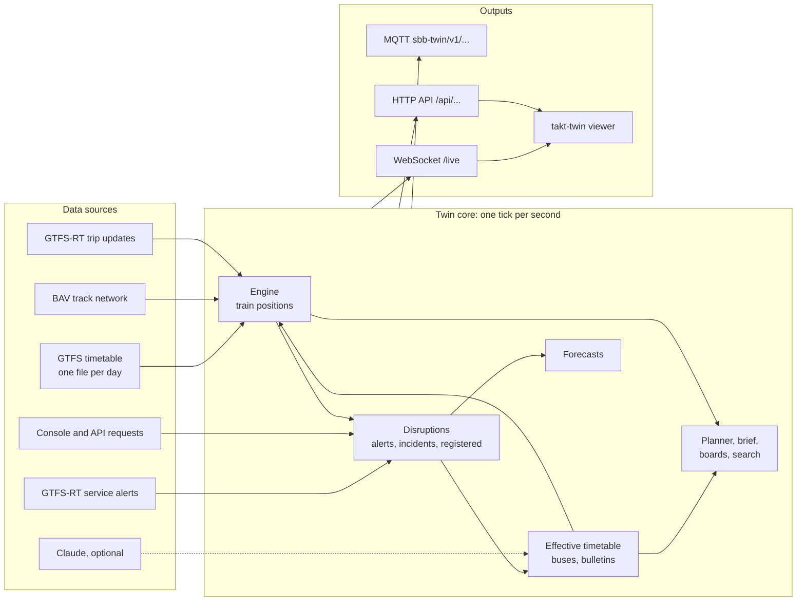

# How the twin works

How the deployed twin ([twin.latragallucci.dev](https://twin.latragallucci.dev)) works, from the data it reads to what
it publishes. The [README](../README.md) is the reference for MQTT topics and HTTP endpoints, and
[forecasts.md](forecasts.md) covers the forecasts. The code is in `src/` (the twin, TypeScript on Node.js),
`viewer/src/` (the web app, **takt-twin**), and `tools/` and `data/` (data preparation).

## 1. What the twin is

sbb-twin is a live model of every train in Switzerland. Every second it computes where each train is on the real track,
from the official timetable and real-time predictions. It also keeps the disruptions on the railway: real SBB service
alerts, incidents it detects itself, and disruptions that staff register in its console, which change what trains do and
the timetable passengers see and produce a passenger bulletin. Everything is published on MQTT, on a WebSocket for the
console and on an HTTP API, which also plans journeys.



## 2. Data

**The timetable** comes from the official Swiss GTFS (opentransportdata.swiss), prepared before the twin runs into one
file per service day, `data/days/day-YYYY-MM-DD.json.gz`: the day's `stops` as `[id, name, lon, lat]` and its `trips` as
`[key, category, line, headsign, calls]`, where `calls` lists `stop index, arrival, departure` in seconds from the GTFS
time origin of the day (noon minus 12 h, Swiss time; `src/time.ts`). The trips are the rail trips and the timetable's
rail-replacement buses (category `EV`). `src/timetable.ts` loads the current Swiss day's file, and the twin checks every
minute for a new day.

**The track.** `tools/prepare_network.py` builds the geometry from the federal rail network (BAV "Schienennetz"). It
matches each timetable station to a BAV node (by station number, else by name within 300 m) and, for every pair of
consecutive stops of a rail trip, finds the shortest path on the track graph (one graph per gauge), kept only if
plausible: at most 2.5 times the straight distance plus 2 km, and no faster than 250 km/h over the shortest scheduled
running time. It writes `data/network.json.gz` (BAV nodes and edges), `paths.json.gz` (the edges of each station pair),
`network-lines.geojson` (the map layer), `trips-meta.json.gz` (train number, operator and line of each trip) and a
`coverage.json` report; `tools/extract_abroad_rails.mjs` adds `abroad-lines.geojson`, the railways abroad from
OpenStreetMap. `src/geometry.ts` joins a leg's edges into one polyline (`track: "bav"`); a pair without an accepted
path, and every bus leg, is a straight line between the stops (`track: "approx"`).

**Ids.** Stations use the timetable's ids, e.g. `8503000` for Zürich HB; `src/realtime.ts` reduces the stop ids of the
real-time feeds (`ch:1:sloid:10665:0:19728`, `8503000:0:5`) to them. A trip's key is `YYYYMMDD/<trip_id>`, the pair
GTFS-RT uses, and a train's `trainId` is `{YYYYMMDD}_{trip_id without its leading dot}`, e.g.
`20261122_ojp-91-8-E.1.TA.1691.j26`, stable for the whole run. Buses added by a disruption are `{YYYYMMDD}_EV-…`. Track
segments keep their BAV id (`edgeId`).

## 3. How trains move

**The tick.** `src/main.ts` runs one tick per wall-clock second: the registered disruptions update the effective
timetable, buses and bulletins, the engine (`src/engine.ts`) moves every train, and everything is published with that
second's timestamp. Every 5 seconds the engine puts the trips about to run into service: a train appears 2 minutes
before its first departure and leaves a minute after its last arrival. `RAIL_REPLAY` (`src/clock.ts`) runs the twin on a
virtual clock instead, for scripted replays of real disruptions (`src/replay.ts`).

**The timeline.** GTFS-RT (`src/realtime.ts`, polled every 13 s) has no vehicle positions: per trip it gives predicted
delays or times at its stops, the stops it skips and whether it is cancelled. The engine turns this into each train's
reference timeline: planned times shifted by each stop's prediction (a stop without one keeps the delay of the stop
before), never leaving before the planned departure, each leg taking at least 60 % of its planned running time, and
about 20 s at a stop whose timetable shows no dwell. Without a GTFS-RT key the timeline follows the planned times.

**On the track.** The engine keeps each train's time `tau` on its timeline, which gives the station it stands at or the
leg it runs on. On a leg the train follows a trapezoidal speed profile, accelerating, cruising and braking so that the
leg takes exactly its time (0.7 m/s² for regional trains, 0.45 m/s² for long-distance trains, 0.9 m/s² for buses). The
distance covered is placed on the leg's polyline: latitude, longitude, bearing and BAV segment. When new predictions
arrive the train does not jump: the gap to the new timeline is absorbed at a quarter of a second per second. A gap over
five minutes is applied at once and raises the train's `continuity` counter, so maps do not interpolate across it. A
trip cancelled in GTFS-RT shows as cancelled for a minute, then leaves service.

**Taken over by a disruption.** When a disruption acts on a train (a closed section ahead, a speed limit, a breakdown),
the train leaves its timeline for simulated driving (`mode: "sim"`): it accelerates at most at its rate, brakes at 0.7
m/s², obeys speed limits and stops before points it may not pass, and at a station it waits (`held`) while its next leg
is closed. Its lag behind the timeline becomes its delay. Train protection works like ETCS: the movement authority ends
350 m behind the train ahead on the same track and direction, so a stopped train holds the trains behind it. When the
disruption ends the train rejoins its real timeline and catches up its lag gradually; `POST /api/sync` puts trains
straight back on the real data.

**Abroad.** Trains that run abroad (TGV, EC, TER, …) are in the timetable like any other, and their legs outside the BAV
network are straight lines. `src/abroad.ts` joins the BAV network and the railways abroad into one graph, used to draw a
real SBB alert whose section lies outside the Swiss network along the foreign railway.

**Every second** the twin publishes `fleet` (every train in one message of compact rows), `trains/{trainId}/position`
for every train and, when a train's run changed (delay in 30-second steps, next stop, skipped or cancelled calls, new
destination), the retained `trains/{trainId}/info`, at most every 10 s (at once when it is cancelled). `delaySec` is the
delay at the next stop; `motion` only says what an observer sees, `moving` or `stopped` (`cancelled` in `fleet`).

## 4. Disruptions

| Source | Code | Changes the trains? |
|---|---|---|
| Real SBB service alerts on the railway | `src/alerts.ts` | no: GTFS-RT already carries their effect |
| Automatic incidents: what trains are seen doing | `src/auto.ts` | no |
| Registered disruptions: a cause on a section or a station, with the control centre's decisions | `src/scenario.ts`, `src/catalogue.ts` | yes |
| Train actions: a breakdown or a cancellation of one train | `src/disruptions.ts`, `src/god.ts` | yes |
| Incidents marked by staff (`POST /api/incidents`) | `src/disruptions.ts` | no |

**Real SBB alerts.** Every 3 minutes `src/alerts.ts` reads the Swiss GTFS-RT service alerts and keeps the active ones
that name a station served today or a train of today's timetable, or are tagged `[train]` or `[rack railway]`. A title
such as "between A and B" is drawn on the track between the two stations; otherwise the alert points at its stations.
Alerts with the same title merge under one id (`sa-…`); severity comes from the text (`major` for interruptions, `minor`
for limited service, delays or works). They are published on `alerts/{id}`.

**Automatic incidents.** `src/auto.ts` watches only what trains do and opens public incidents (`incidents/{id}`,
`source: "auto"`) that close on their own 20 s after their condition ends:

| Rule | Scope | Severity |
|---|---|---|
| a train stopped on the open line for 30 s | section | major |
| slow running: steadily under 40 % of the pace the timetable needs for 60 s, away from stations | section | minor |
| a train still at a station 3 minutes after it should have left | station | minor, major from 2 trains |
| a train 10 min late, or 4 min late and losing 2 min within 3 min | train | minor, until under 4 min late |
| a cancelled train | train | minor |

### Registering a disruption

`POST /api/disruptions` with a `cause` (what the console sends) registers a **cause**, one of 19 SBB reason codes
(`GET /api/disruption-types`) with defaults from 550 real incidents (usual effect, median duration, kind of end, share
with a replacement bus); a **place**, a section `{kind: "section", from, to}` or a station `{kind: "station", station}`;
a **state** (`effect`), `interrupted` (no train passes) or `limited` (trains pass slowly), later `resumed`; and an
**expected end**, `until` with a `durationType`: `UNTIL` ("until approx."), `UNTIL_AT_LEAST` or `UNKNOWN`. For a section
the twin takes every way trains run between the two stations today, parallel lines included, and closes the stations in
between with it; for a station, the legs to and from it and the track within 500 m.

It also computes a **proposal**, the plan the control centre would most likely choose: hold the trains if the line
reopens within 20 minutes, otherwise short-turn them at both ends; one track open with every second train cancelled for
limited service; buses every 15 minutes when at least half of the real incidents of that cause had one. It is applied
only on request (`applyProposal: true` or `POST …/proposal/accept`).

### Decisions (measures)

Decisions go to `POST /api/disruptions/{id}/measures` and are withdrawn with `…/measures/{mid}/withdraw`. Each takes
effect at its own time (`at` or `inMin`; epoch ms, `HH:MM` or ISO).

| Measure | Effect |
|---|---|
| `hold` | trains wait at the last station before the section until it reopens; `maxWaitMin` (default 20) is the longest wait before a short turn applies |
| `short_turn` | a train that would wait longer ends at the last open station before the section, its later stops cancelled (`at`: `A`, `B` or `both`; the time then goes in `effectiveAt`) |
| `replacement_bus` | buses (`EV`) run both ways between the two ends |
| `cancel_lines` | trains of the given `lines` (e.g. `["S2", "S25"]`) end before the section |
| `one_track_open` | limited service at `kmh` (default 40); a share `cancelShare` of the trains (default 0.5) ends before the section |
| `partial_resumption`, `interruption` | the state becomes limited, or interrupted again |
| `prognosis` | a new expected end (`until` or `minutes`, `durationType`) that holds, short turns and buses follow |
| `resume` | service resumes: held trains continue, future buses are withdrawn |

`POST /api/disruptions/{id}/state` and `…/end` are shortcuts. A disruption also resumes when its announced end comes.

### The effective timetable

From the record and its decisions, `recompute` in `src/scenario.ts` derives the **effective timetable**: a change for
each affected trip (`tripChanges`), rebuilt every 5 seconds and after each decision. For each trip due on the affected
track in the next 6 hours it takes the station before the first affected leg and the state the disruption will be in
when the train gets there. A cancelled line is **cut** there (its run ends); while interrupted the trip is **held**
until the expected end, or **cut** if a short turn applies and the wait would be longer than the maximum; while one
track is open, the chosen share is **cut**. A cut at the first station becomes a **late start**: the trip enters service
after the section. A train that reached its short-turn station keeps that change for the day.

The engine, `trains/{trainId}/info` (new destination, cancelled calls, `disruptionId`), station boards, briefs and the
planner all read these changes, and a held trip is forecast to leave at the expected reopening. The engine adds the
physics: an interrupted section's track is closed (trains wait at the station before it or stop 150 m short), a limited
one is capped at 40 km/h or the decision's `kmh`, and a cut train stops at its new terminus and leaves service 90 s
later. Buses are not on the rails, so neither applies to them.

**Replacement buses** are real trips in the effective timetable, so the fleet, boards and planner show them. They run
both ways between the two ends, calling at the stations in between, at the straight distance × 1.3 at 50 km/h plus a
minute at each stop: the first `firstInMin` after the decision takes effect (default 15), then every `everyMin` (default
15), or at fixed minutes past each hour (`minutesA`, `minutesB`), until the withdrawal (`withdrawAt`), the expected
reopening (two hours ahead, rolling, when it is unknown) or six hours ahead. `sought: true` announces buses being
organised.

**Train actions.** Without a `cause`, `POST /api/disruptions` acts on one train
(`{type, scope: {kind: "train", trainId}}`): `breakdown` stops it where it is and turns the section it blocks into a
registered disruption (`EG_014`, train blocking the line), both ending when the train is released
(`POST /api/trains/{trainId}/release`); `cancellation` ends its run at the next station.

**Ending.** `POST /api/disruptions/{id}/end` (**Service resumed** in the console) lets held trains go, withdraws future
buses and starts the forecast of trains to check; the disruption stays listed for 30 minutes. `DELETE` removes it with
its buses, bulletin and incident. `POST /api/control/reset` (**Sync with live**) removes every disruption and incident
and puts every train back on the real data; real SBB alerts stay. Disruptions and marked incidents are saved to
`RAIL_STATE_FILE` and restored at startup.

## 5. Bulletins

Each registered disruption has a public bulletin, rendered by `render` in `src/scenario.ts` from the record alone, in
the structure of SBB's English bulletins. The title is `Interrupted service: A - B`, `Limited service: A - B` or
`Service resumed: A - B`. The description has one sentence per line: state and place, cause ("This is due to a defect in
the overhead line."), expected end ("The restriction lasts until approx. 14:30."), for interrupted service the lines due
through the section, "Allow for delays and cancellations.", "No trains are running." or the one-track sentence, and the
replacement bus sentence. `messages` add one entry per decision.

The bulletin is rendered again every tick, and a new version is published whenever its text changes: at registration,
when a decision is announced or takes effect, at resumption. Each version goes to `bulletins/{disruptionId}` (retained)
and updates the public incident `incidents/{disruptionId}` (`source: "control"`). `GET /api/bulletins/{id}` returns the
latest and up to 60 versions.

**Claude's wording.** With `ANTHROPIC_API_KEY` set, `src/bulletinAI.ts` asks Claude Haiku (`BULLETIN_MODEL`) to rewrite
each new text in SBB's style, from the facts as JSON, the template text and real SBB bulletins of the same kind
(`src/bulletin-examples.json`: interrupted, interrupted with buses, limited, resumed, in four languages). The answer
must pass `validate`: the same number of lines, the facts' lines, section stations and end time, and nothing else (no
other line, station, time, number, platform or diversion). It is then published as the next version with `source: "ai"`;
otherwise the template stands. The template is always published first, so a bulletin never waits for the model.

**Languages.** Bulletins are written in English. With the key, German, French and Italian versions are prepared in the
background and served by `GET /api/bulletins/{id}?lang=de|fr|it`; if none is ready within `BULLETIN_TIMEOUT_MS`, the
answer is the English bulletin with `translationError`.

## 6. Briefs, boards and search

**`GET /api/brief`** (`src/brief.ts`) answers in one call what matters for a place, from the twin's state only (no model
call), for the passenger assistant. With `?station=`: the registered disruptions touching the station or its departing
trains, the real SBB alerts naming it, the next departures and `trainsToCheck` after a recent resumption. With
`?from=&to=`: the same for every station where the next three journeys board, change or alight, plus those `journeys`.
With `?lat=&lon=`: the nearest served station within 50 km. Each disruption carries its bulletin, state, expected end,
decisions, next buses and duration `forecast`. **`GET /api/situation`** (`src/planner.ts`) is the equivalent for one
train (`?trainId=`: its state, and the incidents and alerts on its remaining route), a station or a route.

**Boards and arrivals.** `GET /api/stations/{id}/board` lists the next departures in the effective timetable: live
times, held trains at their forecast departure, short-turned trains with their new destination (`plannedHeadsign` keeps
the old one), cancelled departures marked `cancelled`, replacement buses included. `GET /api/stations/{id}/arrivals`
lists the trains on their way to the station, nearest first, with `etaSec`, `stopsAway` and `status` (`approaching` or
`at_station`).

**Search.** `GET /api/search?q=` feeds the console's search box: stations, lines in service, and trains in service by
public number, line or destination, ignoring accents and case.

## 7. The journey planner

`src/planner.ts` plans journeys on the twin's live state. It answers `GET /api/plan`, gives the journeys of a brief, and
keeps each journey it returns for 30 minutes for `GET /api/journeys/{id}`.

### What it plans on

The **effective timetable** at the time of the request:

- today's trips, with the replacement buses added by registered disruptions;
- each trip at its live times: a train in service where the twin is driving it (late, held or slowed), a trip not yet
  running at its planned times shifted by GTFS-RT;
- the changes of section 4: a cut trip ends at its new terminus, a late start begins after the section, a held trip
  leaves at the expected reopening;
- without the trips cancelled in GTFS-RT or cut at their first station; a stop a trip skips cannot be used;
- in the evening and at night, the next morning's trips too (the next day's file, loaded in the background).

From them it builds **connections**: one per pair of consecutive served stops of each trip, sorted by departure. A rail
trip that would enter a closed section before its expected reopening gets no connection from there on; buses are never
stopped. The list covers six hours after the requested time (until 08:00 the next morning for requests after 20:00 or
before 05:00). It is rebuilt when the effective timetable changes and refreshed every 4 seconds, so a request for the
current time never waits for it.

### The search

A **Connection Scan** (CSA) for the earliest arrival, with a bound on the number of trains. It scans the connections in
departure order and keeps, for every station and every number of trains used (1 up to `maxTransfers + 1`), the earliest
time a passenger can be there; boarding a trip counts one more train, staying on it does not. At the end it reads one
journey per number of trains and keeps it only if it arrives earlier than every journey with fewer trains, so one search
returns the fastest journey and the journeys with fewer changes that arrive later. The scan stops once a connection
leaves after the best one-train arrival, or more than 90 minutes after the earliest arrival.

**Changes.** At the origin a passenger boards at the train's departure. A change between two trains, or a train and a
bus, is made at the station where the passenger alights and takes at least 4 minutes, at every station.

**More options.** The search is repeated with later departures (one minute after the earliest departure of the previous
round) until twice `limit` journeys are found, and a journey longer than three hours (a night wait at a change) gets a
variant that leaves as late as possible with the same arrival. With `via` the search is chained (origin to via, via to
destination). With `includeWait=true`, for each interrupted section on the way (through it is at most 1.35 times the
straight distance plus 5 km) it also searches a journey that crosses the section on one direct train after the expected
reopening (`kind: "wait"`).

### Ranking, `fastest` and uncertain options

The journeys are sorted by arrival, then number of changes. A regular option (`kind: "best"`) arriving more than 90
minutes after the earliest is dropped, except at night, when the first services of the next morning are offered
(`nextServiceDay: true`). An option another beats on every count (leaves no earlier, arrives no later, no more changes)
is dropped unless it goes another way, a **corridor** (its change stations) that no better or already kept option uses:
it is then kept with `dominated: true`. At most `limit` options are returned, plus the `wait` options, ordered by
arrival.

A journey through an interrupted section (on a held train, or after the reopening) has `waitsForReopening: true`, a
warning and a leg `note` ("Wädenswil – Pfäffikon SZ reopens at the earliest 12:00"). It is **uncertain**
(`uncertain: true`) when the reopening is not confirmed: the end is "at least until" or unknown. **`fastest: true`**
marks the journey to recommend: the earliest arrival among the journeys that are not uncertain (the earliest of all when
every one is).

Each leg has a `status` (`on time`, `late` from 3 minutes, `held` when its train is stopped by a disruption or held at a
station) and the `incidents` on it (incidents naming its train, its stops or a section between them; real alerts naming
its train or two of its stops). The journey's `warnings` say the same in words and name replacement bus legs.

### Calling it

| `GET /api/plan` | Meaning |
|---|---|
| `from`, `to` | station id (`8507000`) or name (`Bern`), resolved to the best match among stations served today |
| `after` | earliest departure, epoch ms (default: now) |
| `limit` | number of options, 1 to 6 (default 4) |
| `maxTransfers` | most changes allowed, 1 to 4 (default 3) |
| `via` | a station to go through |
| `includeWait` | `true` or `1`: add journeys that wait for an interrupted section to reopen |

```sh
curl "https://twin.latragallucci.dev/api/plan?from=8507000&to=8501689&maxTransfers=2"
```

The answer from the live twin on 22 November 2026 (Bern to Zermatt), trimmed to the first of its three journeys (times in
epoch ms):

```json
{
  "from": {"id": "8507000", "name": "Bern", "lon": 7.439129, "lat": 46.948831},
  "to": {"id": "8501689", "name": "Zermatt", "lon": 7.747835, "lat": 46.024},
  "generatedAt": 1795339962792,
  "journeys": [
    {
      "id": "j-451e41a212",
      "departure": 1795342063000, "arrival": 1795349820000,
      "plannedDeparture": 1795342020000, "plannedArrival": 1795349820000,
      "durationMin": 129, "transfers": 1, "arrivalDelayMin": 0, "warnings": [],
      "legs": [
        {
          "trainId": "20261122_ojp-91-8-E.1.TA.1699.j26", "line": "IC8", "category": "IC", "headsign": "Brig",
          "from": {"id": "8507000", "name": "Bern", "lon": 7.439129, "lat": 46.948831, "plannedDep": 1795342020000, "expectedDep": 1795342063000},
          "to": {"id": "8501605", "name": "Visp", "lon": 7.881468, "lat": 46.294026, "plannedArr": 1795345440000, "expectedArr": 1795345441000},
          "stopsBetween": 2, "delaySec": 1, "status": "on time", "incidents": []
        },
        {
          "trainId": "20261122_ojp-91-41-G.1.TA.2.j26", "line": "R41", "category": "R", "headsign": "Zermatt",
          "from": {"id": "8501605", "name": "Visp", "lon": 7.881468, "lat": 46.294026, "plannedDep": 1795345860000, "expectedDep": 1795345860000},
          "to": {"id": "8501689", "name": "Zermatt", "lon": 7.747835, "lat": 46.024, "plannedArr": 1795349820000, "expectedArr": 1795349820000},
          "stopsBetween": 6, "delaySec": 0, "status": "on time", "incidents": []
        }
      ],
      "kind": "best", "corridor": ["Visp"], "fastest": true
    }
  ],
  "alternativesConsidered": 7, "corridorsConsidered": 1, "searches": 8, "maxTransfers": 2
}
```

An unknown station answers `404` with `{error}`. `GET /api/journeys/{id}` returns the journey with every stop of every
leg, recomputed at request time: planned and expected times and `served` (false for a skipped stop or a call cancelled
by a short turn or a cancellation). `GET /api/geometry/journey/{id}` gives each leg's track as a GeoJSON LineString.
An unknown or expired journey id answers `404`: plan again.

## 8. Forecasts

For the real SBB alerts and registered disruptions, the twin forecasts how long a disruption will last (the chance it is
still on at +1, +2 and +4 hours, the expected end with an 80 % band, and whether the announced end looks optimistic),
which regular trains to check in the hour after "Service resumed", and a risk map of the network's sections, from JSON
models trained offline in `research/`. They are published on `forecasts/disruptions` and
`forecasts/post-resumption/{disruptionId}`, served under `GET /api/forecasts`, and shown in the console's Forecasts tab,
the Risk map toggle and the evidence page `/forecasts`. They are advice only and never change the effective timetable or
the planner. See [forecasts.md](forecasts.md).

## 9. Outputs

**MQTT.** All topics are under `sbb-twin/v1/` (`TOPIC_ROOT`); payloads are JSON with a schema version `v`, times are
epoch milliseconds, and an empty retained message is a tombstone. Without `MQTT_URL` the twin runs its own broker,
reachable over WebSocket at `/mqtt`, where clients may publish only under `detections/{team}/…` and `ext/{team}/…`. With
`MQTT_URL` it publishes to that broker, and `/mqtt` becomes a read-only WebSocket proxy to it that adds the credentials
on the server.

| Topic | Content |
|---|---|
| `status` | heartbeat every 10 s (retained) |
| `fleet`, `trains/{trainId}/position` | every train, every second |
| `trains/{trainId}/info` | a train's run and calls (retained) |
| `incidents/{id}` | public incidents: marked by staff, detected automatically, or a registered disruption (retained) |
| `alerts/{id}` | real SBB service alerts on the railway (retained) |
| `bulletins/{disruptionId}` | the latest bulletin of a registered disruption (retained) |
| `forecasts/disruptions`, `forecasts/post-resumption/{disruptionId}` | forecasts (retained) |
| `events/incident`, `events/train`, `events/system` | public events |
| `truth/disruptions/{id}`, `truth/trains/{trainId}`, `truth/events` | ground truth for evaluation: what was registered and the trains it took over |

The [README](../README.md#topics) documents each topic and payload.

**WebSocket `/live`** (`src/channel.ts`) is the console's own link, fed straight from the engine: the latest messages
and the last 80 events on connect, then `tick` every second (fleet rows and status), `state` when disruptions,
incidents, bulletins or forecasts change, `alerts` after each alerts poll, `event` as events happen, and `train` every
second for the train the page watches (it sends `{"watch": "<trainId>"}`).

**HTTP API**, base path `/api`. A change (POST, DELETE) updates the effective timetable, bulletins, forecasts and the
console at once; invalid input answers `422` with `{error}`. The [README](../README.md) is the full reference.

| Purpose | Endpoints |
|---|---|
| Trains, stations | `GET /status`, `/trains`, `/trains/{trainId}`, `/stations?q=`, `/search?q=`, `/stations.geojson`, `/stations/{id}/board`, `/stations/{id}/arrivals`, `/stations/{id}/neighbours` |
| Passengers | `GET /plan`, `/journeys/{id}`, `/brief`, `/situation`, `/geometry/journey/{id}`, `/geometry/train/{trainId}`, `/geometry/section` |
| Registered disruptions | `GET /disruption-types`, `/measure-types`, `/disruptions`, `/disruptions/{id}`; `POST /disruptions`, `/disruptions/{id}/measures`, `/disruptions/{id}/measures/{mid}/withdraw`, `/disruptions/{id}/proposal/accept`, `/disruptions/{id}/state`, `/disruptions/{id}/end`; `DELETE /disruptions/{id}` |
| Bulletins, incidents, alerts | `GET /bulletins`, `/bulletins/{id}?lang=`, `/incidents`, `/alerts`; `POST /incidents`; `DELETE /incidents/{id}` |
| Train actions, reset | `GET /train-actions`, `/control/state`; `POST /trains/{trainId}/release`, `/control/release-all`, `/sync`, `/control/reset` |
| Forecasts, replays, map | `GET /forecasts`, `/forecasts/scorecards`, `/forecasts/shadow`, `/forecasts/section-risk.geojson`, `/forecasts/post-resumption`, `/replays`, `/network.geojson`, `/abroad.geojson`; `POST /replays/{name}/start` |

## 10. The viewer and control console

**takt-twin** (`viewer/src`, React and MapLibre) is served at `/` by the twin. It reads trains, disruptions and alerts
over `/live` and uses the HTTP API for boards, search, forecasts and decisions.

- **Map**: swisstopo's light base map, the BAV network, the railways abroad and the stations served today. Trains are
  drawn on a canvas, interpolated between the one-second updates: an arrow when moving, a dot when standing; green,
  orange from 3 minutes late, blue at a station, red stopped on the open line, grey cancelled. Disruptions are drawn on
  their track, red (interrupted) or orange (limited).
- **Train card** (click a train, or `/?train=<trainId>`): line, operator, number, speed, delay and the next stops;
  **Follow** keeps the map on it. **Station card** (click a station): its departure board.
- **Search box**: `/` focuses it from anywhere; it finds lines, trains, stations and listed disruptions, and a picked
  line keeps its trains bright while the others fade.
- **Side panel**: **Disruptions** lists the registered disruptions, real SBB alerts and incidents with a place on the
  map, the most severe first; picking one frames it and fades the trains not involved. **Bulletins** shows their texts
  and **Forecasts** the forecasts (`/?tab=forecasts`).
- **Register disruption**: the console, in three steps: *Disruption* (cause, section or station, interrupted or limited,
  expected end), *Decisions* (a pre-selected plan: short-turn with replacement buses, short-turn only, hold until it
  reopens, or one track open) and *Done* (the bulletin). Registered disruptions are listed there with **Add buses**,
  **Short-turn trains**, **Partially reopened** or **Interrupted again**, **Service resumed**, and remove.
- **Sync with live** puts the twin back on the real data; **Risk map** shows the section risk layer (`/?risk=1`).
- **Light, dark or like the system**: remembered in the browser and applied before the first paint; page, map and trains
  cross-fade together.

## 11. Running it

```sh
npm install
npm run dev     # twin, API and viewer (Vite, hot reload) on one port
npm run build   # build the viewer into viewer/dist
npm start       # production mode: the twin serves viewer/dist
```

Without keys and `MQTT_URL` the twin follows the planned timetable and runs its own MQTT broker. For a private test
instance next to the live twin, use another `PORT`, `TOPIC_ROOT` and `RAIL_STATE_FILE`, and no `MQTT_URL`.

**Docker.** The `Dockerfile` builds the viewer and collects the forecast models (the JSON and GeoJSON files of
`research/`) in a first stage, then copies `src/`, `data/`, the built viewer and the models into a production image that
runs the twin on port 8787, with a health check on `/api/status`. It publishes no port: a reverse proxy in front reaches
it. The live twin is deployed with Coolify, which rebuilds it on every push to `main`; keys reach the container as
environment variables.

| Variable | Purpose |
|---|---|
| `PORT`, `HOST`, `NODE_ENV` | where the server listens; `production` serves the built viewer |
| `OTD_GTFS_RT_KEY`, `OTD_GTFS_RT_URL`, `RT_INTERVAL_MS` | GTFS-RT trip updates: key (without it, the planned timetable), address, polling interval |
| `OTD_GTFS_SA_KEY`, `OTD_GTFS_SA_URL`, `SA_INTERVAL_MS` | GTFS-RT service alerts: key, address, polling interval |
| `MQTT_URL`, `MQTT_USERNAME`, `MQTT_PASSWORD`, `TOPIC_ROOT` | publish to this broker instead of the embedded one; topic root |
| `ANTHROPIC_API_KEY`, `BULLETIN_MODEL`, `BULLETIN_TIMEOUT_MS`, `BULLETIN_BACKGROUND_MS` | bulletin wording and translations by Claude |
| `RAIL_DATA_DIR`, `RAIL_DAYS_DIR`, `RAIL_RESEARCH_DIR`, `RAIL_STATE_FILE` | prepared geometry, day timetables, forecast models, saved state |
| `RAIL_ENV_FILE` | a private env file read at startup (variables already set win) |
| `RAIL_REPLAY`, `RAIL_REPLAY_SPEED`, `RAIL_REPLAY_SCENARIO` | replay clock and scripted replay |
| `SCENARIO_WARN_MS` | log a warning when rebuilding the effective timetable takes longer than this |
